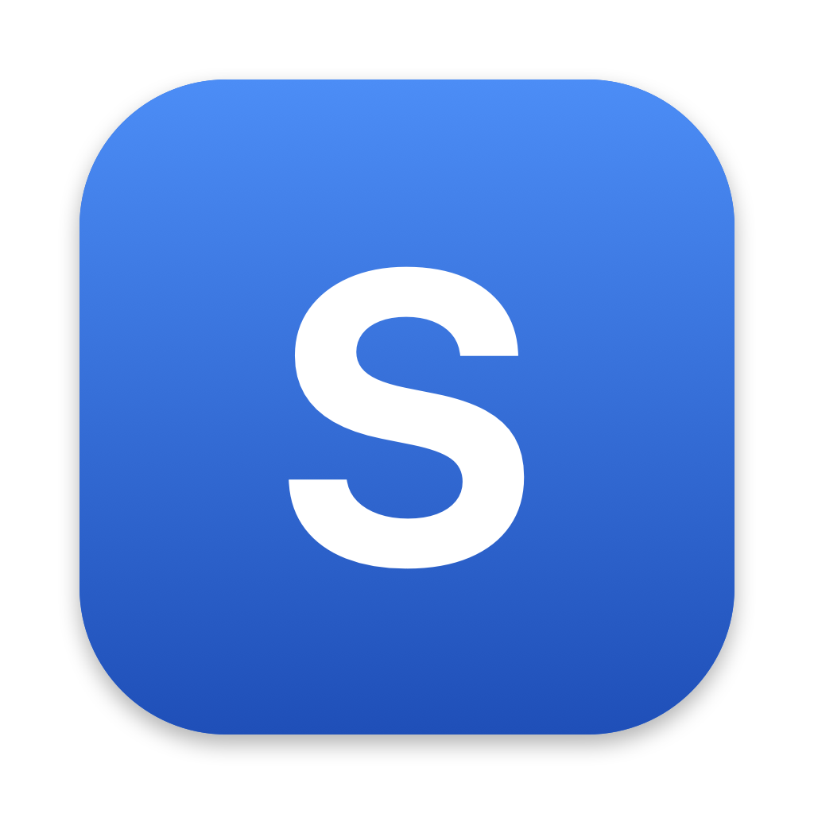

# Stowaway



[](LICENSE)

A native macOS app. Available in English and Slovak (follows the macOS language setting).

## Download

Install it with [Homebrew](https://brew.sh): `brew install --cask furcenzo/tap/stowaway`, or download the zip
from [Releases](https://github.com/Furcenzo/stowaway/releases). The app is not notarized by Apple: on the first launch
open **System Settings → Privacy & Security** and click **Open Anyway**.

Requires macOS 15 or later.

## Building

Requires Xcode (or the Swift 6 toolchain).

```sh
swift build && swift test
./scripts/build-app.sh      # "build/Stowaway Dev.app"
./scripts/run.sh [sk|en]    # build and start it
```

`scripts/` comes from [mac-app-kit](https://github.com/Furcenzo/mac-app-kit), the shared scripts of the
author's Mac apps; the settings of this app are in `app.conf`.

## License

GPL-3.0-or-later – see [LICENSE](LICENSE). Copyright (C) 2026 Furcenzo.
