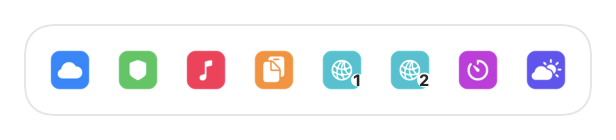
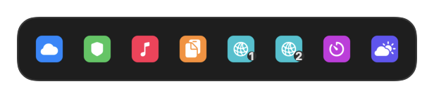

# Stowaway


[](LICENSE)

A menu bar manager for **macOS 27**. Keep only the icons you want in the menu bar; the others stow away in a bar
under the Stowaway icon (a suitcase), where one click opens their real menu. Useful on a MacBook with a notch, where
icons that don't fit simply disappear behind it.

Available in English and Slovak (follows the macOS language setting).

<p align="center">
  
  
</p>

The screenshots show sample apps; they are drawn by the app itself (`scripts/screenshots.sh`).

> **Early version.** Stowaway relies on a private macOS API (see [How it works](#how-it-works)), so a macOS update
> can break it. When hiding stops working, Stowaway shows every icon again and tells you why.

## Features

- **Hide icons** – everything except the apps and system items you keep (right click → *Keep in Menu Bar*).
- **The bar** – left click on the suitcase shows the hidden apps; a click opens the app's real menu.
  Hover for the app's name, drag the icons to reorder them.
- **Show All Icons** – pause hiding at any time; quitting Stowaway (or a crash) brings every icon back.
- Order of the icons left in the menu bar: macOS's own ⌘-drag.

## Requirements

- macOS 27 (tested on 27.2).
- Stowaway must run from the **Applications** folder, otherwise macOS hides its own icon too.
- **Accessibility** permission (System Settings → Privacy & Security → Accessibility): to see which apps have
  icons and to click them. Screen Recording is not needed.

## How it works

macOS 27 draws every menu bar icon in a single window of the system process MenuBarAgent, so the techniques of
earlier menu bar managers (moving each icon's window, a wide separator pushing icons off screen) no longer work.

- **Hiding** uses `MBAssessmentModeAssertion` of the private MenuBarClientCore framework – an allow-list meant for
  exam (assessment) mode. Only the allowed apps and system items stay in the menu bar.
- **Opening** a hidden icon allows its app for a moment, clicks its real icon and hides it again when the menu closes.
- **Which apps have icons** is read through Accessibility from MenuBarAgent while they are visible.

Limits that follow from this:

- Hiding works per app, not per icon: an app with several icons shows or hides all of them.
- Only nine system items can stay visible (battery, Bluetooth, clock, displays, keyboard, sound, Wi-Fi,
  screen mirroring, Control Center); others such as Focus or Spotlight are hidden while hiding is on.
- The bar shows app icons, not the live menu bar icons.

## Download

Install it with [Homebrew](https://brew.sh): `brew install --cask furcenzo/tap/stowaway`, or download the zip
from [Releases](https://github.com/Furcenzo/stowaway/releases) and move `Stowaway.app` to **/Applications**.
The app is not notarized by Apple: on the first launch open **System Settings → Privacy & Security** and click
**Open Anyway**. Then allow Accessibility when Stowaway asks for it; it hides nothing until then.

## Building

Requires Xcode 27 (or the Swift 6 toolchain) on macOS 27.

```sh
swift build && swift test
./scripts/build-app.sh      # "build/Stowaway Dev.app"
./scripts/run.sh [sk|en]    # build and start it
```

`scripts/` comes from [mac-app-kit](https://github.com/Furcenzo/mac-app-kit), the shared scripts of the
author's Mac apps; the settings of this app are in `app.conf`. [PLAN.md](PLAN.md) has the background and the plan
for when the private API changes.

## Contributing

Issues and pull requests are welcome – especially reports of how Stowaway behaves on other macOS 27 builds.

## Credits

Thanks to [Ice](https://github.com/jordanbaird/Ice) and [Thaw](https://github.com/thaw-app/Thaw), whose public work
on menu bar management informed the research. Stowaway contains no code from them.

## License

GPL-3.0-or-later – see [LICENSE](LICENSE). Copyright (C) 2026 Furcenzo.
